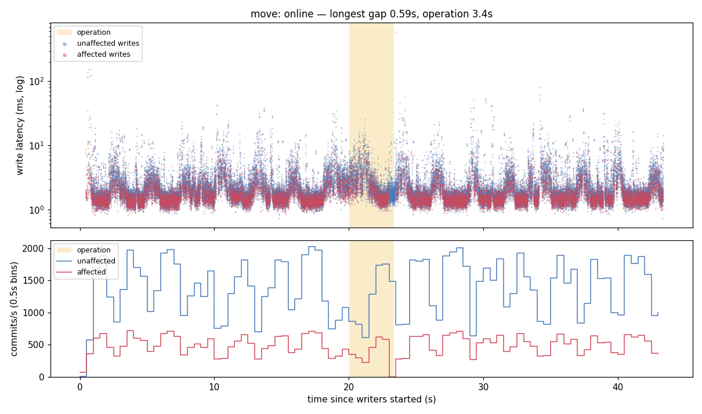
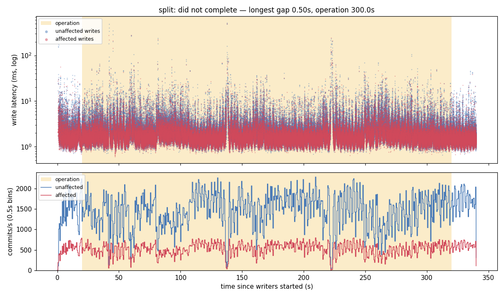
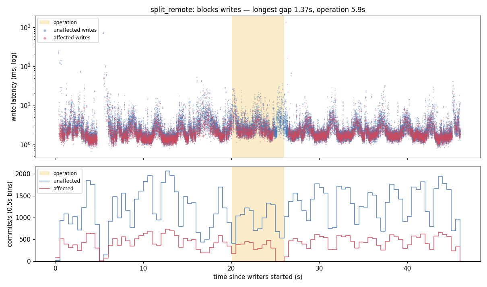
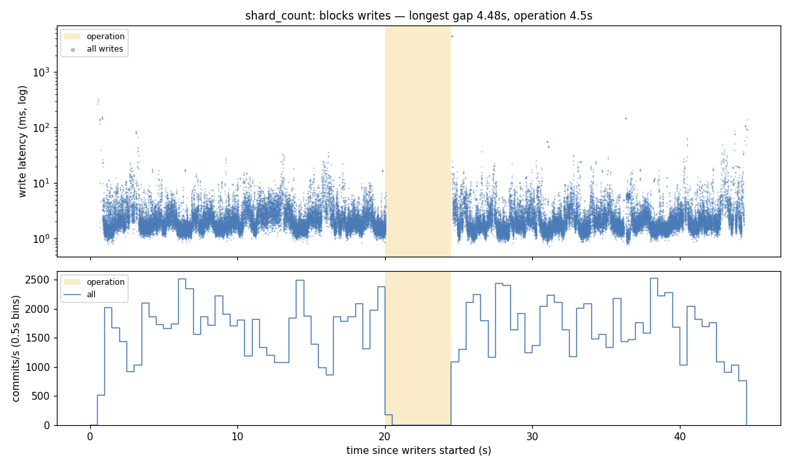
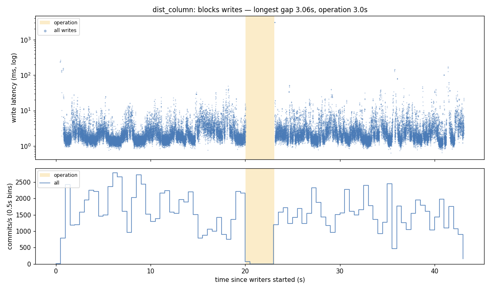

# Phase 0 spike: which Citus operations block writes

> **Timings are under emulation.** The cluster ran on Apple Silicon with the
> amd64-only `citusdata/citus` image under Rosetta. These results are valid for
> **whether an operation blocks writes, and the rough size of any write gap**.
> They are not valid for absolute latency, throughput or operation duration.
> Even with nothing running, the baseline shows stalls of up to ~0.7 s across
> all writers, so gaps under about a second are within noise.

Citus 14.2.0, PostgreSQL 17.10, one coordinator + three workers
(`bench/docker-compose.yml`, `wal_level=logical`), all operations with
`shard_transfer_mode => 'auto'`. One run per operation, each on a freshly
created cluster.

## Summary

| Operation | Completed | Writes to the affected data | Errors | Verdict |
|---|---|---|---|---|
| `citus_move_shard_placement` (worker1 → worker2) | yes, 3.4 s | longest gap **0.59 s**, at cutover | 0 | **online** |
| `citus_split_shard_by_split_points`, halves on worker1 + worker2 | **no, cancelled at 300 s** | never interrupted (longest gap 0.50 s) | 0 | **did not complete in 300 s** |
| `citus_split_shard_by_split_points`, halves on worker2 + worker3 | yes, 5.9 s | longest gap **1.37 s**, at cutover | 0 | online except for a short cutover pause (1.37 s, over the 1 s threshold) |
| `alter_distributed_table(shard_count := 64)` | yes, 4.5 s | **no commits for 4.48 s**, the whole operation | 0 | **blocks writes** |
| `alter_distributed_table(distribution_column := 'id')` | yes, 3.0 s | **no commits for 3.07 s**, the whole operation | 0 | **blocks writes** |

No writer got an error in any run. Where writes stopped, they waited (on
locks) and went through once the operation finished.

## Method

- **Table:** `t(id bigint, k bigint, v text, PRIMARY KEY (id, k))`, distributed on
  `k` with 32 shards, 1M rows, `k = id % 100003` (`setup.sql`).
- **Load:** four writer threads, each with its own autocommit connection, in a tight
  loop of 50% `INSERT` of a new row and 50% `UPDATE … WHERE id = $1 AND k = $2`
  of an existing row. Every write is logged with start, end and error.
  - **move / split:** the shard is the lowest-numbered one on worker1 (`102008`,
    3,066 of the 100,003 `k` values). One thread writes only keys in that
    shard (*affected*); three write only keys outside it (*unaffected*).
  - **alter_distributed_table:** the whole table is rewritten, so all four threads
    write across the whole table.
- **Timeline:** 20 s baseline, then the operation, then 20 s more, with
  timestamps from the same clock as the writers.
- **Metrics:**
  - *Longest gap* is the longest interval between consecutive successful commits
    (of the affected thread, or of all threads for the alter operations) that
    overlaps the operation window.
  - *Max latency* is the slowest single write overlapping that window.
  - For move and split, the unaffected threads' throughput is compared with
    their own baseline.
- **Verdict rule (set before running):** "blocks writes" if the longest gap
  exceeds max(1 s, 20 × baseline p99). Every baseline p99 was 7–10 ms, so the
  threshold was always 1 s.
- **Timeout:** an operation still running after 300 s is cancelled. If it is
  still running at 60 s and 240 s, the harness first snapshots activity,
  locks, replication state and container logs on every node.

## Detail

### Move: online



The affected thread's only notable gap is 0.59 s, from 2.93 s to 3.52 s
after the start: the end of the operation, when Citus blocks writes to the
shard briefly to finish catching up and switch the placement. The unaffected
threads never stalled (longest gap 10 ms, max latency 30 ms). Their mean
throughput during the move was 88% of baseline; the lowest 0.5 s bin (45%) is
within the baseline's own range (lowest baseline bin 51%).

### Split with one half on the source node: did not complete



`citus_split_shard_by_split_points(102008, ['-2080374785'], [worker1, worker2])`
was still running at 300 s and was cancelled. The same thing happened in an
earlier run, which I cancelled by hand after 503 s.

Writes were never affected: the parent shard kept serving reads and writes
for the whole 300 s (longest affected gap 0.50 s, no errors). The two dips
to near zero at ~137 s and ~222 s hit the affected and unaffected threads
together, so they are emulation stalls, not the split.

**Why it did not complete:** diagnostics in
[`results/diagnostics/split-60s.txt`](results/diagnostics/split-60s.txt) and
[`split-240s.txt`](results/diagnostics/split-240s.txt).

- **Not a lock wait.** No backend on any node is blocked (`pg_blocking_pids`
  is empty everywhere, `citus_lock_waits` is empty), and the writers keep
  committing to the parent shard `t_102008` throughout.
- **Not slow catch-up.** The half going to worker2 (slot
  `citus_shard_split_slot_3_10_1`) is caught up in both snapshots: 920 bytes
  and then 888 bytes behind, replay lag 1 ms.
- **The half staying on worker1 never applies a single change.** Its
  subscription on worker1 (target `t_102040`) has no apply worker. Every
  attempt fails on the first replicated UPDATE with:

  ```
  ERROR:  publisher did not send replica identity column expected by the
          logical replication target relation "public.t_102040"
  CONTEXT:  processing remote data for replication origin "pg_17453" during
            message type "UPDATE" for replication target relation "public.t_102040"
  ```

  Postgres restarts the worker every ~5 s and it fails the same way: 14
  apply errors at 60 s, 50 at 240 s. The slot's confirmed position never
  moves (`0/4AA50D0` in both snapshots), so its lag only grows: 17 MB at
  60 s, 62 MB at 240 s.
- The coordinator's split waits in `Extension` for both subscriptions to
  catch up (`SELECT min(latest_end_lsn) FROM pg_stat_subscription …`), which
  cannot happen. The function has no timeout of its own and would wait
  indefinitely.

Consequences beyond "it doesn't finish":

- The stuck slot holds WAL on the source node indefinitely, so under
  sustained writes a hung split eventually fills the disk.
- Nothing reports an error. The only signs are the apply-worker errors in
  the worker's log and `apply_error_count` in `pg_stat_subscription_stats`.

I have not found the root cause. The failure is specific to the split child
placed on the **source** node: the same split with both halves on other nodes
(next section) completes in 6 s under the same load. It is a logical
replication error, not a timing effect, so emulation is an unlikely cause, but
that is not ruled out until it reproduces on native hardware (see the arm64 /
x86 TODO in `docs/PLAN.md`). Next step: minimise it (no load / INSERT-only /
UPDATE-only, one table) and report it to Citus if it reproduces natively.

### Split with both halves on other nodes: online except for a short cutover pause



The same split, but placing the halves on worker2 and worker3, completed in
5.9 s. The affected thread's longest gap is 1.37 s, from 4.76 s to 6.14 s,
straddling the end of the operation (5.95 s): the cutover, as with the move.
That is above the 1 s threshold, so the rule labels it "blocks writes". But
it is a pause at the switch, not a block for the length of the copy, unlike
`alter_distributed_table`. On this setup it is inflated: the same baseline
has a 0.7 s stall across all threads at ~5 s with nothing running. The
unaffected threads never stalled (longest gap 20 ms).

### alter_distributed_table(shard_count := 64): blocks writes



No thread commits anything from 0.02 s after the operation starts until
it ends 4.5 s later. Every write waits, and the slowest takes 4.52 s. Writes
resume immediately afterwards with no errors, against a table that now has 64
shards. This is a full rewrite, and the write outage lasts as long as the
rewrite. With 1M rows that was a few seconds; it is expected to grow with
table size, but this spike did not measure that.

### alter_distributed_table(distribution_column := 'id'): blocks writes



Same pattern: no commits for 3.07 s, the whole operation. Afterwards the
table is distributed on `id`, and the writers carry on without errors (their
statements send both `id` and `k`).

## What this means for ShardML

- **Moves are online**, with a sub-second write pause at cutover on this setup.
- **Splits are online only when neither half stays on the source node.** Splitting
  with one half kept in place hung indefinitely, twice, with no error surfaced. Until
  that is understood, a migration plan should place both halves away from the
  source node, and the executor needs its own timeout plus a check of
  `pg_stat_subscription_stats.apply_error_count` and slot lag, rather than
  trusting the function call to return.
- **Changing shard count or distribution column with `alter_distributed_table`
  blocks writes for the entire rewrite.** An online bucket-count change has to be
  built from splits and moves. An online shard-key change has no Citus primitive
  at all, which confirms it as the gap ShardML targets.

## Reproduce

```sh
bench/spike/run.sh                       # all five, ~20 min emulated
bench/spike/run.sh split split_remote    # a subset
```

`run.sh` creates a venv in `bench/spike/.venv` (psycopg, matplotlib) on first
run. For each operation it recreates the cluster (`down.sh` + `up.sh`), loads
the table and runs the operation under load. Then `analyze.py` writes
`results/results.json` and the plots. Raw per-write CSVs go to `results/raw/`
(gitignored, ~40 MB).

The results above come from two invocations. The first ran move, split,
shard_count and dist_column; its split was the one cancelled by hand at
503 s. The second ran split and split_remote after the timeout and
diagnostics capture were added. Move, shard_count and dist_column ran without
those additions, which neither changed nor would have triggered for
operations that finished in seconds.
